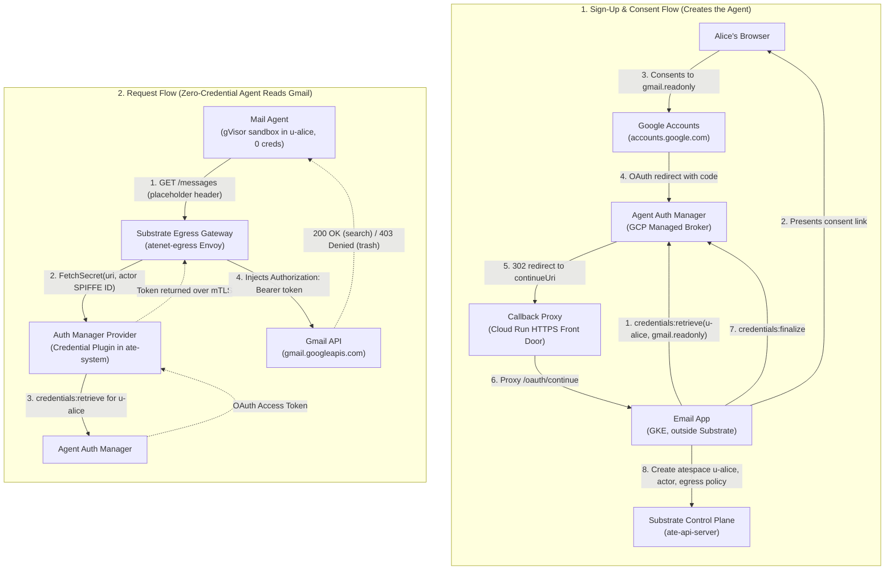

# Pleading the Agent: OAuth without a token in the sandbox

Demo for the talk *Pleading the Agent: proof of agent identity* (Agent Substrate Day, Nov 2026).

[Talk slides are also in the repo](atecon2026_agent_identity_slides.pdf).

An AI agent runs inside an [Agent Substrate](https://github.com/agent-substrate/substrate) gVisor sandbox with **zero ambient credentials**. It reads a user's Gmail using an OAuth token stored and managed by Google Cloud Agent Auth Manager. Substrate's egress gateway transparently injects the token into outgoing requests based on the actor's verified SPIFFE identity. The sandbox never holds a token, the token is strictly bounded to `gmail.readonly`, and all API calls are logged under the agent's cryptographic identity.

## Architecture



## How It Works

### Phase 1: User Sign-Up & Agent Creation
1. **User Sign-Up:** Alice registers with the email app (`POST /signup?email=alice@gmail.com`). No agent exists yet.
2. **Consent Link Generation:** The email app calls Auth Manager's `credentials:retrieve` API for user `u-alice` and scope `gmail.readonly`. Auth Manager returns a Google OAuth authorization URL.
3. **User Consent:** Alice opens the authorization link in her browser. Google's OAuth consent screen displays the requested read-only scope.
4. **Two-Hop Token Hand-off:**
   * Google redirects Alice's browser with the OAuth authorization code to Auth Manager's callback (`agentidentitycredentials.googleapis.com/.../oauthcallback`).
   * Auth Manager terminates the OAuth exchange, obtains refresh and access tokens, saves them in its vault keyed by user `u-alice`, and redirects Alice's browser to the email app's `continueUri` (`https://email-app-callback-...a.run.app/oauth/continue`).
5. **Finalization & Agent Provisioning:** The email app receives the callback, calls Auth Manager's `credentials:finalize` API, and creates Alice's isolated Substrate atespace (`u-alice`), actor template, actor (`mail-agent`), and egress policy through Substrate's control plane API (`ate-api`).

### Phase 2: Agent Execution & Egress Token Injection
1. **Sandboxed Request:** The agent runs in a gVisor sandbox with no tokens or GCP metadata server access. To search mail, it issues a standard HTTPS request to `gmail.googleapis.com` with a dummy placeholder `Authorization` header.
2. **Egress Interception:** Substrate's egress gateway (`atenet-egress`) intercepts the traffic and evaluates the actor's egress policy.
3. **SPIFFE-Attributed Credential Resolution:** The egress policy specifies a credential source URI: `ate-secret://authmanager.demo/gmail-oauth/gmail.readonly`. The gateway calls Substrate's credential provider plugin (`authmanager-provider`) over mTLS, passing the URI and the actor's verified SPIFFE ID (`spiffe://substrate-actor.local/actor/u-alice/mail-agent`).
4. **Scope & Identity Enforcement:** The provider extracts the atespace (`u-alice`) from the SPIFFE ID and validates the scope against the URI. An agent can only ever request tokens belonging to its own user's atespace. The provider fetches an active OAuth access token from Auth Manager.
5. **Gateway Token Injection:** The gateway replaces the placeholder header with `Authorization: Bearer ya29...` before forwarding the request to Google.
6. **Least-Privilege Enforcement:** Read requests succeed with HTTP 200. Destructive operations (such as `messages.trash`) are rejected by Google with HTTP 403 `ACCESS_TOKEN_SCOPE_INSUFFICIENT` because the token is strictly scoped to `gmail.readonly`.

## Walkthrough: What You See in the Demo

The demo runs in ~90 seconds across 5 steps:

| # | Step | Command | What it demonstrates |
|---|---|---|---|
| 1 | Sign-Up & Consent | `email-app signup alice@gmail.com` | Signs Alice up. The app outputs the copy-paste consent URL and waits. The operator clicks through consent in the browser. |
| 2 | Provisioned Agent & Policy | `kubectl ate get actors`, `kubectl ate get egress-policy` | Shows that the app created atespace `u-alice`, actor `mail-agent`, and a 1-rule egress policy allowing only `gmail.googleapis.com` with token injection. |
| 3 | Search Mail (200 OK) | `agent search` | The agent searches Alice's inbox for subject "Agent Substrate Day:". Google returns 200 OK with subjects. The sandbox never held the token. |
| 4 | Trash Mail (403 Refused) | `agent trash` | The agent attempts to delete a message. Google refuses with 403 `ACCESS_TOKEN_SCOPE_INSUFFICIENT`. |
| 5 | Egress Logs | `kubectl logs` | Egress gateway logs show each Gmail call (200, 403) attributed to the agent's SPIFFE ID. |

## Component Layout

```
cmd/
  agent/                CLI and HTTP server running inside the Substrate actor sandbox
  email-app/            Multi-tenant application running on GKE (signs users up, provisions agents)
  authmanager-provider/ Substrate credential provider plugin (gRPC mTLS) translating SPIFFE IDs to Auth Manager tokens
  callback-proxy/       Lightweight Cloud Run reverse proxy providing a public HTTPS endpoint for /oauth/continue
internal/
  identity/             Email to atespace naming conversions (RFC 1123 compliant)
  authmanager/          Client for Google Cloud Agent Auth Manager REST API
  provider/             Implementation of Substrate CredentialProvider gRPC service
  emailapp/             HTTP handlers for /signup and /oauth/continue
  substrate/            Client for Substrate ate-api gRPC control plane
  gmail/                Gmail API search and trash client
  tlsutil/              Mutual TLS certificate parsing and SPIFFE ID validation
deploy/                 Kubernetes manifests, ConfigMaps, and Containerfile
demo/
  demo.sh               Automated, interactive demo runner using demo-magic
  reset.sh              Cluster and Auth Manager state reset script for fresh takes
scripts/
  setup.sh              One-time cloud infrastructure provisioning (GKE, Artifact Registry, Auth Manager)
  up.sh                 Substrate installation and demo workload deployment
  lib.sh                Shared environment verification, build helpers, and kubectl-ate wrapper
```

## Running the Demo

### Prerequisites
* Google Cloud project with billing enabled
* `gcloud` CLI (v592.0.0+ with `agent-identity` and `gke-gcloud-auth-plugin`)
* `kubectl`, `podman`, `go` 1.27, `jq`, `envsubst`, `git`
* `pv` (optional, for terminal typing animation)

### 1. Initial Setup (One-time)
Create and populate `demo.env`:
```bash
cp demo.env.example demo.env
$EDITOR demo.env
```

Run the infrastructure setup:
```bash
scripts/setup.sh
```
This script creates the GKE cluster, Artifact Registry repository, snapshot bucket, service accounts, and Auth Manager provider. When prompted, create an external OAuth 2.0 Web Client in the Google Cloud Console with the printed redirect URI, and supply the Client ID and Secret.

### 2. Execution
Run `demo/reset.sh` before each demo take to revoke Alice's grant, delete her atespace and agent, and flush caches:
```bash
demo/reset.sh
```

Run the demo script:
```bash
demo/demo.sh        # Interactive mode: press ENTER to advance commands
demo/demo.sh -n     # Non-interactive mode: advances automatically
```

Tips:
* At Step 2, copy the printed authorization link into a browser signed into `DEMO_EMAIL` and click Allow. The script resumes automatically once the agent is created.
* `demo/reset.sh` can be executed between takes without redeploying the infrastructure.
* `TOP_PAD=6 demo/demo.sh` adds top padding to keep command output centered vertically on screen.
* `TYPE_SPEED_OVERRIDE=40 demo/demo.sh` adjusts typing speed.

## Automated Verification

Run unit tests inside the Go container:
```bash
podman run --rm -v "$PWD":/src:Z -w /src mirror.gcr.io/library/golang:1.27 go test -race ./...
```
