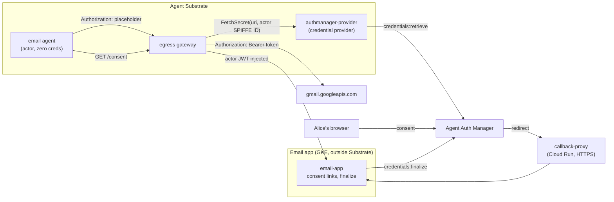

# Pleading the Agent: OAuth without a token in the sandbox

Demo for the talk *Pleading the Agent: proof of agent identity* (Agent
Substrate Day, Nov 2026). It shows the "scoped secret" rung of the talk's
attribution ladder.

An AI agent runs in an [Agent Substrate](https://github.com/agent-substrate/substrate)
sandbox with **zero credentials**. It reads a user's Gmail through an OAuth
token that Google Cloud Agent Auth Manager holds and that Substrate's egress
gateway adds to the agent's requests on the way out. The agent never sees the
token, the token is scoped to `gmail.readonly`, and every call is logged under
the agent's own identity.

OAuth is what most APIs (every Google API) offer today. This is how you use it
without putting a token in the sandbox.

## What you'll see

| # | On screen | What it shows |
|---|---|---|
| 1 | `agent audit` | The sandbox has no secret env vars, no credential files and no metadata server: `zeroAmbientVerified: true`. |
| 2 | `agent search` | Gmail call is refused by Substrate's egress gateway (403): Alice hasn't granted access yet. |
| 2b | `agent consent` | The app hands the agent a consent link. It knows which agent is asking from an actor JWT the gateway injected. |
| 3 | browser | Alice consents to "View your email messages and settings" (`gmail.readonly`). |
| 4 | `agent search`, `agent audit` | Same call now returns 200 with up to 3 subjects matching `Agent Substrate Day:`. The sandbox still holds no token. |
| 5 | `agent trash` | Google refuses with 403 `ACCESS_TOKEN_SCOPE_INSUFFICIENT`: the token can't delete mail. |
| 6 | logs | The egress gateway logs the call under the agent's SPIFFE ID; the credential provider logs which actor got which user's token. |

## How it works



- **`cmd/agent`** runs in the actor. It sends a placeholder `Authorization`
  header; the gateway replaces it.
- **`cmd/authmanager-provider`** implements Substrate's credential provider
  plugin API (`FetchSecret`). The user is the actor's atespace, taken from the
  SPIFFE ID the gateway verified (`alice@gmail.com` → atespace
  `alice-gmail-com`), so an agent can only ever get its own user's token. URIs
  name only the scope: `ate-secret://authmanager.demo/oauth/gmail.readonly`.
- **`cmd/email-app`** is the application, on plain Kubernetes. It gives agents a
  consent link (a credential provider can only return a secret or an error, so
  consent has to come from the app), finalizes the grant when the browser
  returns, and lets the operator drive the agent through Substrate's ingress
  router.
- **`cmd/callback-proxy`** is the app's HTTPS front door on Cloud Run, so the
  browser lands on a page with a valid certificate. It forwards only
  `/oauth/continue` to the app over the VPC.
- **`deploy/egress-policy.yaml`**: the agent may reach exactly Gmail (with the
  OAuth token injected) and the app's consent endpoint (with an actor JWT
  injected). Nothing else.

## Setup

You need: a Google Cloud project, `gcloud` (logged in), `kubectl`, `podman`,
`go` 1.27, `jq`, `envsubst`, `git`, and `pv` for the typing effect.

1. Configure:

   ```bash
   cp demo.env.example demo.env
   $EDITOR demo.env   # PROJECT_ID, DEMO_EMAIL, region/cluster names
   ```

   `DEMO_EMAIL` is the Google account whose mail the agent reads.
   `DISPLAY_EMAIL` (default `alice@gmail.com`) is what the demo shows on screen.
   `demo.env` is git-ignored.

2. Create everything and deploy:

   ```bash
   scripts/setup.sh
   ```

   It enables APIs, creates the GKE cluster, Artifact Registry repo, snapshot
   bucket and service account, and the Auth Manager provider, then runs
   `scripts/up.sh` to install Substrate (built from source at
   `SUBSTRATE_COMMIT`) and deploy the demo. Every step is idempotent.

   Partway through it asks you to create an OAuth client in the Cloud console
   (it prints the exact steps and redirect URI), then reads the client ID and
   secret from your terminal. Use a project whose OAuth consent screen can be
   External, and add `DEMO_EMAIL` as a test user.

To redeploy after code changes: `scripts/up.sh` (or `SKIP_SUBSTRATE=1
scripts/up.sh` to skip reinstalling Substrate).

## Run the demo

```bash
demo/reset.sh      # fresh agent, revoke any earlier grant
demo/demo.sh       # press ENTER to advance each step
demo/demo.sh -n    # unattended: no typing or pauses
```

- At step 3 the script prints a short consent link and saves the full one to
  `.cache/consent-url.txt`. Open it in a browser signed in as `DEMO_EMAIL` and
  allow access. The script continues by itself once the grant is finalized.
- Only the newest consent link works: each request starts a new attempt.
- Run `demo/reset.sh` before each take. If Google skips the consent screen
  because it remembers the earlier grant, remove the app at
  <https://myaccount.google.com/connections> and run it again.
- `TYPE_SPEED_OVERRIDE=40 demo/demo.sh` types faster.

## Tests

```bash
podman run --rm -v $PWD:/src:Z -w /src mirror.gcr.io/library/golang:1.27 go test -race ./...
```

## Layout

```
cmd/            agent, email-app, authmanager-provider, callback-proxy
internal/       identity, authmanager client, provider, emailapp, gmail, audit, actorjwt, tlsutil
deploy/         Kubernetes manifests, actor template, egress policy, Containerfile
scripts/        setup.sh (one-time environment), up.sh (install + deploy), lib.sh
demo/           demo.sh (walkthrough), reset.sh
third_party/    Substrate credential provider API (Apache-2.0), demo-magic.sh (MIT)
```
