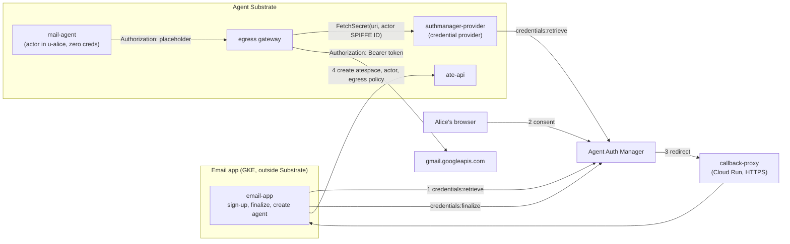

# Pleading the Agent: OAuth without a token in the sandbox

Demo for the talk *Pleading the Agent: proof of agent identity* (Agent
Substrate Day, Nov 2026). It shows the "scoped secret" rung of the talk's
attribution ladder.

An AI agent runs in an [Agent Substrate](https://github.com/agent-substrate/substrate)
sandbox with **zero credentials**. It reads a user's Gmail through an OAuth
token that Google Cloud Agent Auth Manager holds and that Substrate's egress
gateway adds to the agent's requests on the way out. The agent never sees the
token, the token is scoped to `gmail.readonly`, and every call is logged under
the agent's own identity.

OAuth is what most APIs (every Google API) offer today. This is how you use it
without putting a token in the sandbox.

## What you'll see

Two parts, matching the talk's slides: Alice signs up (and consents) before any
agent exists, then her agent makes requests.

| # | On screen | What it shows |
|---|---|---|
| 1 | `gcloud agent-identity auth-providers describe` | The app's OAuth client in Auth Manager: allowed scope `gmail.readonly`, Auth Manager's redirect URL (it receives and stores the tokens), and the email app's continue URI. |
| 2 | `email-app signup alice@gmail.com` | Alice signs up at the app, prints the copy-paste consent link (`gmail.readonly`), and waits for browser consent and agent creation. |
| 3 | `kubectl ate get actors`, `kubectl ate get egress-policy` | The app has created atespace `u-alice`, the actor `mail-agent` and its one-rule egress policy through the Substrate API. |
| 4 | `agent search` | 200 with up to 3 subjects matching `Agent Substrate Day:`. The agent never holds the token. |
| 5 | `agent trash` | Google refuses with 403 `ACCESS_TOKEN_SCOPE_INSUFFICIENT`: the token can't delete mail. |
| 6 | logs | The egress gateway logs each Gmail call (200, 403) under the agent's SPIFFE ID; the credential provider logs which actor got which user's token. |

## How it works



- **`cmd/email-app`** is the application, on plain Kubernetes:
  - At sign-up it asks Auth Manager for a consent link for the user's atespace (`alice@gmail.com` → `u-alice`).
  - When the browser returns, it finalizes the grant and then creates the user's atespace, actor and egress policy through the Substrate API. It authenticates with a projected ServiceAccount token and is a Substrate global owner (`deploy/global-access-policy.yaml`), because creating atespaces requires that role and a multi-tenant app creates one per user.
  - It lets the operator drive the agent through Substrate's ingress router.
- **`cmd/agent`** runs in the actor. It sends a placeholder `Authorization`
  header; the gateway replaces it.
- **`cmd/authmanager-provider`** implements Substrate's credential provider
  plugin API (`FetchSecret`). The user is the actor's atespace, taken from the
  SPIFFE ID the gateway verified, so an agent can only ever get its own user's
  token. URIs name only the scope:
  `ate-secret://authmanager.demo/gmail-oauth/gmail.readonly`.
- **`cmd/callback-proxy`** is the app's HTTPS front door on Cloud Run, so the
  browser lands on a page with a valid certificate. It forwards only
  `/oauth/continue` to the app over the VPC.
- **The agent's template and egress policy** are in the `email-app-agent`
  ConfigMap in `deploy/email-app.yaml`. The policy has one rule: Gmail, with
  the OAuth token injected. Nothing else is reachable.

## Setup

You need: a Google Cloud project, `gcloud` (logged in), `kubectl`, `podman`,
`go` 1.27, `jq`, `envsubst`, `git`, and `pv` for the typing effect.

1. Configure:

   ```bash
   cp demo.env.example demo.env
   $EDITOR demo.env   # PROJECT_ID, DEMO_EMAIL, region/cluster names
   ```

   `DEMO_EMAIL` is the Google account whose mail the agent reads.
   `DISPLAY_EMAIL` (default `alice@gmail.com`) is what the demo shows on screen.
   `demo.env` is git-ignored.

2. Create everything and deploy:

   ```bash
   scripts/setup.sh
   ```

   It enables APIs, creates the GKE cluster, Artifact Registry repo, snapshot
   bucket and service account, and the Auth Manager provider, then runs
   `scripts/up.sh` to install Substrate (built from source at
   `SUBSTRATE_COMMIT`) and deploy the demo. Every step is idempotent.

   Partway through it asks you to create an OAuth client in the Cloud console
   (it prints the exact steps and redirect URI), then reads the client ID and
   secret from your terminal. Use a project whose OAuth consent screen can be
   External, and add `DEMO_EMAIL` as a test user.

To redeploy after code changes: `scripts/up.sh` (or `SKIP_SUBSTRATE=1
scripts/up.sh` to skip reinstalling Substrate).

## Run the demo

You can run the demo from any machine (e.g. a laptop) once the environment is
set up. Copy `demo.env` there (it's git-ignored). You need `gcloud` with
`gke-gcloud-auth-plugin`, `kubectl`, `jq` and `curl`; `demo/reset.sh` also
needs `go`, `git` and `envsubst`. On first run the scripts fetch cluster
credentials into `.cache/kubeconfig` (your `~/.kube/config` is not touched),
and `reset.sh` builds `kubectl-ate` from `SUBSTRATE_DIR` (or clones
Substrate into `.cache/substrate` if that path doesn't exist).

```bash
demo/reset.sh      # delete Alice's agent and atespace, revoke her grant
demo/demo.sh       # press ENTER to advance each step
demo/demo.sh -n    # unattended: no typing or pauses
```

- At step 3 the script prints the consent link (also saved to
  `.cache/consent-url.txt`). Paste it into a browser signed in as `DEMO_EMAIL`
  and allow access. The script continues once the app has created the agent. The script continues by itself once the grant is finalized.
- Only the newest consent link works: each sign-up starts a new attempt.
- Run `demo/reset.sh` before each take.
- Each step starts on a cleared screen; `TOP_PAD=6 demo/demo.sh` adds more
  blank lines above it.
- `scripts/up.sh` makes the egress gateway log every request, not just
  errors (Substrate's default is status >= 400 plus a 1% sample).
- `TYPE_SPEED_OVERRIDE=40 demo/demo.sh` types faster.

## Tests

```bash
podman run --rm -v $PWD:/src:Z -w /src mirror.gcr.io/library/golang:1.27 go test -race ./...
```

## Layout

```
cmd/            agent, email-app, authmanager-provider, callback-proxy
internal/       identity, authmanager client, provider, emailapp, substrate (ate-api client), gmail, tlsutil
deploy/         Kubernetes manifests, actor template, egress policy, Containerfile
scripts/        setup.sh (one-time environment), up.sh (install + deploy), lib.sh
demo/           demo.sh (walkthrough), reset.sh
third_party/    Substrate credential provider and control-plane API stubs (Apache-2.0), demo-magic.sh (MIT)
```
